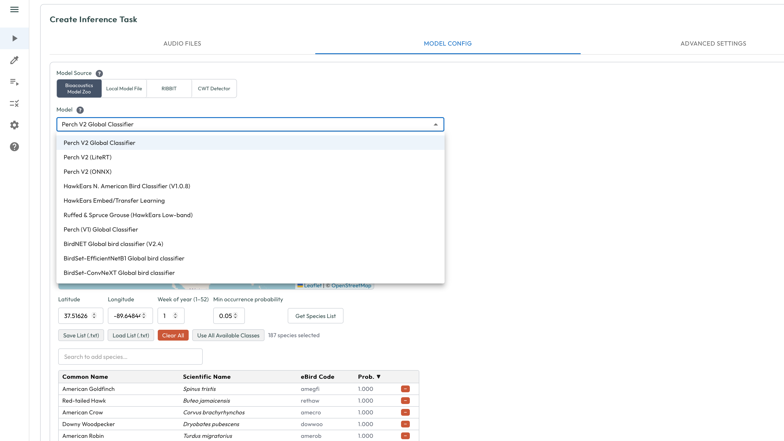
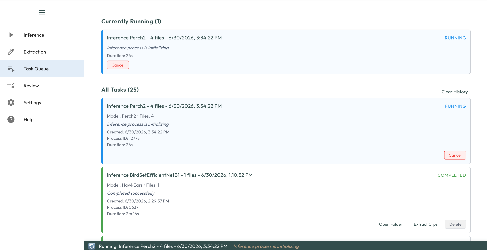
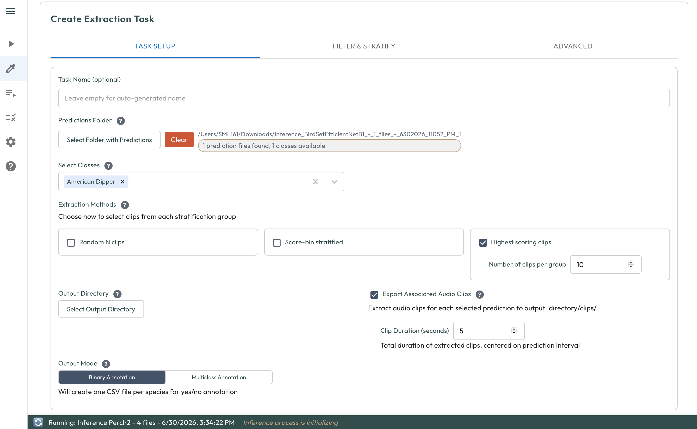
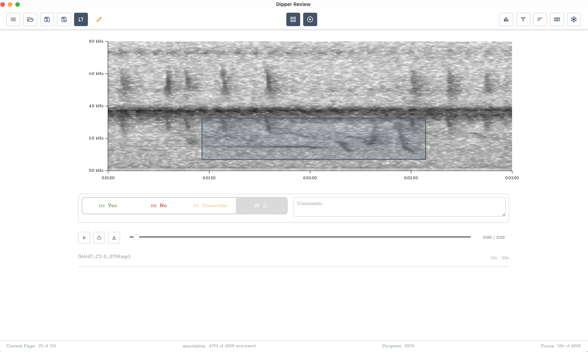

# Dipper

Dipper is a desktop application for finding and labeling animal sounds in audio recordings. Run bioacoustic machine learning models over large audio collections, turn the detections into annotation tasks, and review the results, all without writing code.

[](https://doi.org/10.5281/zenodo.22801983)

Suggested citation:
> Lapp, Sam, and Kitzes, Justin, 2026. Dipper version 0.2.3. DOI: 10.5281/zenodo.22801983


## What you can do with Dipper

- **Run species detection models** on folders of recordings. Choose a pre-trained model from the [bioacoustics model zoo](https://github.com/kitzeslab/bioacoustics-model-zoo/) (Perch, BirdNET, HawkEars and others), or a signal-processing detector such as RIBBIT for pulsed calls. Dipper handles the audio, batching, and writing the results.
- **Create annotation tasks from detections.** Select clips to review, for example the highest-scoring detections for each species, spread across folders or dates.
- **Review and annotate clips** with spectrograms and audio playback. Label clips with presence/absence or multi-class labels, in a grid for quick review or a focused view with surrounding context.
- **Queue long-running jobs.** Tasks run in the background and report progress in the Task Queue, so you can keep working.
- **Use your own computer or a remote server.** Use the desktop app locally, or run Dipper on a GPU server and use it from a web browser ([Server Mode](#server-mode)).

Model training is under development and is not yet enabled in releases.

<p>
  
  
</p>
<p>
  
  
</p>

## Installation

Download the installer for your computer from the **[Dipper download page](https://sammlapp.github.io/dipper/)** (or from the [GitHub releases](https://github.com/sammlapp/dipper/releases/latest)).

| Computer | Download | Notes |
|----------|----------|-------|
| macOS (Apple Silicon) | `.dmg` | Open it and drag Dipper to Applications. Intel Macs are not supported |
| Windows (64-bit) | `-setup.exe` | Run the installer |
| Linux: Ubuntu, Debian, Mint, Pop!_OS | `.deb` | `sudo apt install ./Dipper_*.deb` |
| Linux: Fedora, RHEL, openSUSE | `.rpm` | `sudo dnf install ./Dipper-*.rpm` (openSUSE: `sudo zypper install ./Dipper-*.rpm`) |
| Linux: other distributions, or no admin rights | `.AppImage` | Make it executable (`chmod +x Dipper_*.AppImage`), then run it. If the window stays blank (seen on Ubuntu 26.04), use the `.deb` or `.rpm` |

On Linux, prefer the `.deb` or `.rpm`: they use the system's WebKitGTK and graphics libraries. The AppImage bundles its own copies from an older Ubuntu, which can clash with very new distributions.

Dipper is a 100-200 MB download, plus the machine learning environment described below.

### First launch: install the machine learning environment

Running models needs PyTorch and related software, which is too large to include in the installer. Dipper installs it for you the first time you need it:

1. Open the **Settings** tab and find **ML Environment**.
2. Check the **PyTorch build** (Auto-detect is usually right) and click **Download and Install**.
3. Wait for the install to finish. This can take several minutes. Nothing else needs to be installed on your computer.

Things to know:

- **Internet access is required for this step**, to download the software. The install needs to reach pypi.org, files.pythonhosted.org, download.pytorch.org, and github.com. If your network uses a proxy or blocks these sites, see the advanced network settings in Settings, or ask your IT administrator.
- **Disk space:** about 2.5-4 GB for the CPU build, and roughly 6.5-9.5 GB for the GPU build on Windows and Linux. Dipper shows the expected size and your free space before installing.
- **GPU support:** On Windows and Linux with an NVIDIA graphics card and a recent driver (version 570 or newer), Auto-detect installs the GPU build, which runs models much faster. On Apple Silicon Macs, the GPU is used automatically. Settings shows whether Dipper found a GPU and can use it, and explains why if it can't (hover over the warning icon for details). You can choose CPU only or GPU manually.
- **After updating Dipper**, Settings may show "Update required" if the new version needs different packages. Click **Update**; it only downloads what changed.

### Updating Dipper

Download the newer installer from the download page and install it over the old one.

## Getting started

A typical workflow:

1. **Inference:** pick a folder of audio files and a model, and run it. Detection scores are saved in a results folder.
2. **Task Queue:** watch progress and open results when jobs finish.
3. **Extraction:** turn the detections into an annotation task, choosing which clips to review.
4. **Review:** listen to and label the clips, then save your annotations.

The **Help** tab inside the app explains each tab and its settings.

## Models

Dipper integrates with the [bioacoustics model zoo](https://github.com/kitzeslab/bioacoustics-model-zoo/) and includes:

- **Perch and Perch V2:** global bird species (and more) classification
- **BirdNET:** global bird species classification
- **HawkEars:** Canadian bird classification CNN
- **RIBBIT and CWT detectors:** signal-processing detectors for pulsed and accelerating-pulse calls

## Server Mode

Run Dipper on a remote server and use it from your web browser. This is useful for:
- Running models on a remote GPU server
- Working with large audio collections stored on another machine
- Single-user remote access

```bash
# On the server
./scripts/launch-server.sh [config_file]

# On your computer: tunnel the ports, then open the app in your browser
ssh -L 3000:localhost:3000 -L 8000:localhost:8000 user@remote-server
open http://localhost:3000
```

See [QUICKSTART_SERVER.md](QUICKSTART_SERVER.md) for installation and details.

## Help and resources

- **In the app:** the **Help** tab documents each feature.
- **Downloads and release notes:** [download page](https://sammlapp.github.io/dipper/) and [GitHub releases](https://github.com/sammlapp/dipper/releases).
- **Questions and bug reports:** [open an issue](https://github.com/sammlapp/dipper/issues). Please say which operating system and Dipper version you use, and attach the log file if something failed:

  | | Log file location |
  |---|---|
  | macOS | `~/Library/Logs/Dipper/dipper-backend.log` |
  | Windows | `%LOCALAPPDATA%\Dipper\Dipper\Logs\dipper-backend.log` |
  | Linux | `~/.local/state/Dipper/log/dipper-backend.log` |

- **Related projects:** [OpenSoundscape](https://github.com/kitzeslab/opensoundscape) (the bioacoustics library behind Dipper's models) and the [bioacoustics model zoo](https://github.com/kitzeslab/bioacoustics-model-zoo/).
- **Running Dipper from source or contributing:** see [DEVELOPMENT.md](DEVELOPMENT.md).

## License

This project is licensed under the MIT License.

## Acknowledgments

- [OpenSoundscape](https://github.com/kitzeslab/opensoundscape) for bioacoustics processing
- [Bioacoustics Model Zoo](https://github.com/kitzeslab/bioacoustics-model-zoo/) for pre-trained models
- The bioacoustics research community for datasets and models
